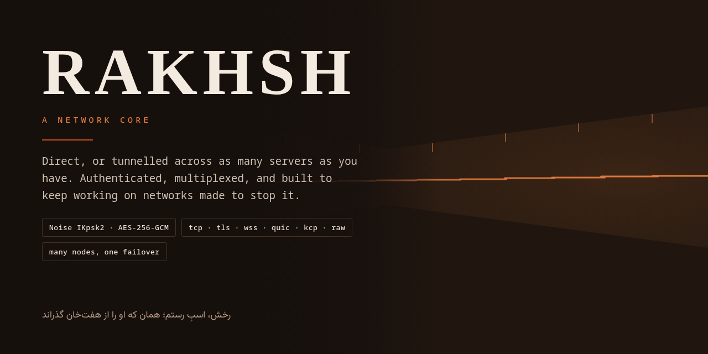
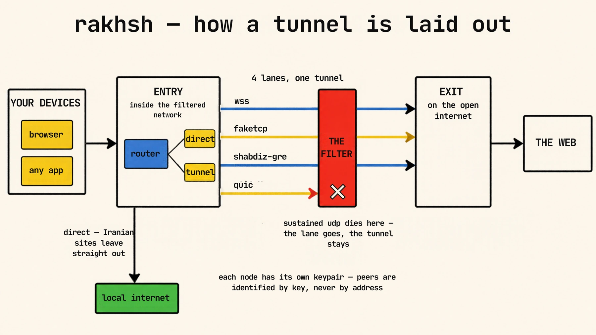
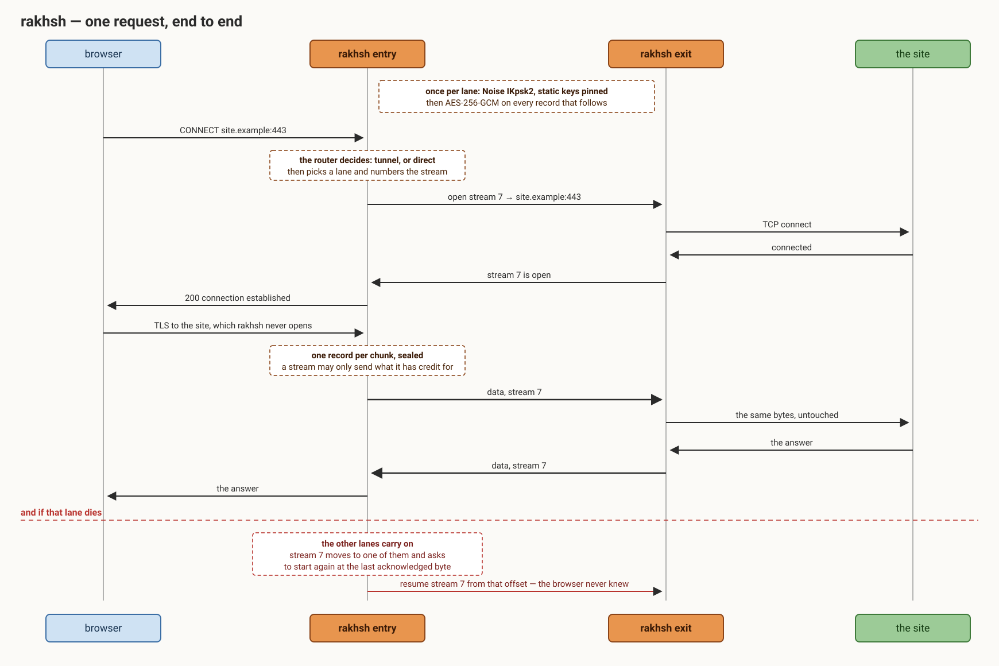

<p align="center">
  
</p>

<p align="center">
  <a href="README.md">English</a> &nbsp;|&nbsp; <b>فارسی</b>
</p>

<div dir="rtl">

# رخش

یک هسته‌ی شبکه، نوشته‌شده با Rust. ترافیک را از جایی که شروع می‌شود به جایی که باید بیرون بیاید
می‌برد (مستقیم روی یک ماشین، یا تونل‌شده روی هر تعداد سروری که داری) و طوری ساخته شده که روی
شبکه‌هایی که می‌خواهند جلویش را بگیرند هم کار کند.

یک باینری. این‌که چه می‌شود را کانفیگش تعیین می‌کند: یک گره‌ی مستقل، سرِ نزدیکِ یک تونل، سرِ دور،
یا یک ناوگانِ کامل از هر کدام.

## چطور چیده می‌شود

</div>

<p align="center">
  
</p>

<div dir="rtl">

## بر سرِ یک درخواست چه می‌آید

</div>

<p align="center">
  
</p>

<div dir="rtl">

## چیست

**یک مسیریاب که تونل درونش است**، نه تونلی که مسیریاب به آن وصل کرده باشند. ترافیک به یک ورودی
می‌رسد، مسیریاب تصمیم می‌گیرد با آن چه کند، و از یک خروجی بیرون می‌رود، مستقیم، یا از تونل. همان
موتورِ تصمیم کار می‌کند، چه تونلی در کار باشد چه نباشد.

**حامل‌های متعدد، یک پروتکل.** دست‌دادن، لایه‌ی رکورد و مالتی‌پلکسر نمی‌دانند بایت‌هایشان چطور از
شبکه رد می‌شوند. این کارِ حامل است، و حامل می‌تواند یک اتصالِ ساده‌ی TCP باشد، یا TLS، یا
WebSocket، یا QUIC، یا یک ARQ روی UDP، یا فریم‌هایی که مستقیم روی کارتِ شبکه نوشته می‌شوند. وقتی
شبکه‌ای یکی از این‌ها را دیگر عبور نداد، یک خط عوض می‌کنی.

**لِین، نه یک اتصال.** هر تونل چند لِینِ مستقل است. از دست دادنِ یکی فقط به جریان‌هایی که روی آن
بودند آسیب می‌زند، و با `resume` حتی به آن‌ها هم نه: به لِینِ دیگری می‌روند و از همان بایتی که
طرفِ مقابل تأییدش کرده ادامه می‌دهند.

**هویت، نه نشانی.** هر گره کلیدِ خودش را دارد و هر طرف فهرستِ هویت‌هایی را دارد که با آن‌ها حرف
می‌زند. یک ورودی می‌تواند بین خروجی‌های واقعاً جدا جابه‌جا شود، یک خروجی می‌تواند به چند ورودی
سرویس بدهد، و برداشتنِ یک گره هیچ تغییری برای بقیه ندارد.

**رمزنگاری و احراز سرتاسری.** دست‌دادنِ Noise IKpsk2 با کلیدهای ثابتِ پین‌شده و یک کلیدِ از-پیش-
مشترک که از توکن ساخته می‌شود، و بعد AES-256-GCM روی هر رکورد.

## نصب

یک خط روی سرورِ خالی، باینری‌ها را می‌گیرد، چند سؤال می‌پرسد، کانفیگ را می‌نویسد، سرویس را نصب
می‌کند، و یک لینک برای سرِ دیگر دستت می‌دهد:

</div>

```
bash <(curl -fsSL https://raw.githubusercontent.com/CluvexStudio/rakhsh/main/install.sh)
```

<div dir="rtl">

روی سرورِ دوم اصلاً سؤالی نیست، همان خطی که سرورِ اول چاپ کرده را بچسبان:

</div>

```
bash <(curl -fsSL .../install.sh) --join rakhsh://…
```

<div dir="rtl">

گزینه‌ی `--panel` پنلِ وب را راه می‌اندازد و یوزرنیم و پسووردِ ساخته‌شده‌اش را چاپ می‌کند.
`--help` بقیه را می‌گوید.

هر ریلیز یک باینریِ استاتیکِ musl برای x86-64، aarch64، armv7، armv6، i686، riscv64،
loongarch64 و ppc64le دارد، هر کدام کنارِ یک چک‌سام که نصاب پیش از نصبِ هر چیزی بررسی‌اش
می‌کند. نسخه‌ی ویندوز برای x64، x86 و ARM64 و نسخه‌ی مک برای اینتل و Apple Silicon هم در همان
ریلیز هست. آنجا همه‌چیز کار می‌کند جز حامل‌های بسته‌ی خام، که لینوکس می‌خواهند؛ فقط faketcp
روی ویندوز هم هست. برایش zipِ `rakhsh-windivert` را بگیر که یک بیلد با faketcp را کنارِ درایورِ
WinDivert دارد. فایل‌ها را کنار هم نگه دار و با Administrator اجرا کن. ممکن است Windows Defender
به WinDivert گیر بدهد چون بسته‌ها را می‌گیرد؛ اگر faketcp می‌خواهی اجازه‌اش را بده.

برای بیلدِ خودت، شبدیز را کنارش کلون کن:

</div>

```
git clone https://github.com/CluvexStudio/shabdiz
git clone https://github.com/CluvexStudio/rakhsh
cd rakhsh
cargo build --release
sudo install -m755 target/release/rakhsh /usr/local/bin/rakhsh
```

<div dir="rtl">

## یک تونل، از صفر

</div>

```
rakhsh init --tunnel-addr <public-address>:7000 --carrier wss --proxy 127.0.0.1:1080
```

<div dir="rtl">

این یک جفتِ هماهنگ کانفیگ با کلید و توکنِ تازه چاپ می‌کند: یکی برای سرِ نزدیک، یکی برای سرِ دور.
هر کدام را روی میزبانِ خودش بگذار، بعد:

</div>

```
rakhsh check -c /etc/rakhsh.toml     # کانفیگ را به زبان ساده برایت می‌خواند
rakhsh install -c /etc/rakhsh.toml   # به‌صورت سرویس اجرایش می‌کند
rakhsh status                        # لِین‌ها، سرعت، افت، پردازنده — زنده
```

<div dir="rtl">

## یک ناوگان، از صفر

چند سرور در هر طرف، هر کدام با کلیدِ خودش:

</div>

```
rakhsh fleet --exit de=1.2.3.4 --exit nl=5.6.7.8 \
             --entry a=10.0.0.1 --entry b=10.0.0.2 \
             --carrier wss --proxy 0.0.0.0:1080 -o ./fleet
```

<div dir="rtl">

یک کانفیگ برای هر گره، به‌علاوه یکی برای میزبانی که همه را مدیریت می‌کند. هر خروجی همه‌ی ورودی‌ها
را می‌پذیرد و برعکس، پس یک گره می‌تواند برود بدون این‌که ناوگان را با خودش ببرد.

## کانفیگ

</div>

```toml
role = "entry"
carrier = "wss"
sni = "www.example.com"
tunnel_listen = "0.0.0.0:7000"
lanes = 4

[[peer]]
name = "de"
public = "کلید عمومی آن گره"
connect = "1.2.3.4:7000"

[[forward]]
listen = "0.0.0.0:443"
target = "127.0.0.1:8443"

[[inbound]]
tag = "proxy"
type = "mixed"
listen = "127.0.0.1:1080"

[route]
final = "tunnel"
```

<div dir="rtl">

فایل [`rakhsh.example.toml`](rakhsh.example.toml) مرجعِ توضیح‌دار است: هر کلیدی که پارسر می‌پذیرد،
دقیقاً یک‌بار، با پیش‌فرض و یکایش و این‌که کدام سمت می‌خواندش. تستی شکست می‌خورد اگر کلیدی از آن جا
بیفتد یا کلیدی را نام ببرد که پارسر نمی‌خواندش.

پوشه‌ی [`examples/`](examples) به‌جایش کانفیگ‌هایی دارد که از آن‌ها شروع کنی، به‌ازای هر شکل یک
جفتِ کارآمد، و همان تست هرکدام را بررسی می‌کند:

| | |
|---|---|
| [`entry.toml`](examples/entry.toml) + [`exit.toml`](examples/exit.toml) | تونل روی wss، با یک فوروارد، یک پراکسی و یک resolver |
| [`openvpn-entry.toml`](examples/openvpn-entry.toml) + [`openvpn-exit.toml`](examples/openvpn-exit.toml) | OpenVPN روی حاملِ دیتاگرامی |
| [`l3-entry.toml`](examples/l3-entry.toml) + [`l3-exit.toml`](examples/l3-exit.toml) | دستگاهِ tunِ مسیریابی‌شده به‌جای فورواردها |
| [`raw-entry.toml`](examples/raw-entry.toml) + [`raw-exit.toml`](examples/raw-exit.toml) | بسته‌های TCPِ جعلی |
| [`node.toml`](examples/node.toml) | پراکسی و مسیریاب روی یک میزبان، بی‌تونل |

مقادیرِ هویتشان جانگهدارهای واضح‌اند؛ `rakhsh init` کلیدهایی می‌نویسد که با هم می‌خوانند.

دستور `rakhsh check` هر کانفیگی را به زبانِ ساده برایت می‌خواند، از جمله چیزهایی که تنظیم نکرده‌ای،
و می‌گوید اگر کلیدی که گذاشته‌ای در این کانفیگ هرگز خوانده نمی‌شود، تا خطی که کاری نمی‌کند خودش
بگویدش، نه این‌که تنظیم‌شده به نظر بیاید.

## بیشتر

| | |
|---|---|
| [CORE.md](CORE.md) | ورودی‌ها، خروجی‌ها و مسیریاب |
| [LINKS.md](LINKS.md) | چند راه برای رسیدن به یک همتا، و این‌که کدام انتخاب می‌شود |
| [شبدیز.md](SHABDIZ.md) | حاملِ دیتاگرامی، برای مسیرهایی که بقیه را رد می‌کنند |
| [RESUME.md](RESUME.md) | زنده نگه داشتنِ جریان‌ها وقتی یک لِین می‌میرد |
| [DNS.md](DNS.md) | ریزالورِ داخلی و مسیریابیِ تفکیک‌شده |
| [LIMITS.md](LIMITS.md) | سهمیه‌ها و محدودیتِ نرخ |
| [CONTROL.md](CONTROL.md) | دیدن و مدیریتِ ناوگان از یک میزبان |
| [SECURITY.md](SECURITY.md) | مدلِ تهدید، و این‌که واقعاً چه چیزی محافظت می‌شود |

## حمایت

اگر رخش برایتان مفید است، یک کمکِ مالی کار را ادامه‌دار می‌کند و هزینهٔ سرورهایی را که
اندازه‌گیری‌ها روی آن‌ها انجام می‌شود می‌پردازد. روی هر شبکه فقط داراییِ همان شبکه را بفرستید.

| شبکه | چه بفرستید | آدرس |
|---|---|---|
| ترون (TRC-20) | TRX / USDT | `TRxVSHcoADZnBfztFmFb2TQopusAwWYEVR` |
| بی‌ان‌بی (BEP-20) | USDT | `0x20c980AEF36Aa71D0A0e7bE382AeD20b73bC6D27` |
| تون (TON) | TON | `UQAH75bXaaRUhZMwiF0ZujOXFDDmvLSPASKoOsWF0HNasiaM` |

## لایسنس

AGPL-3.0-only، فایل [LICENSE](LICENSE).

</div>
