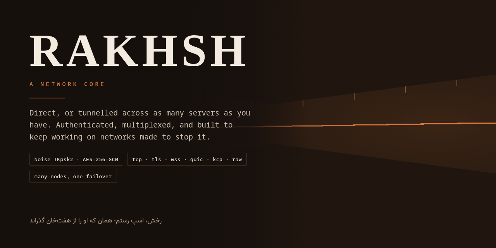
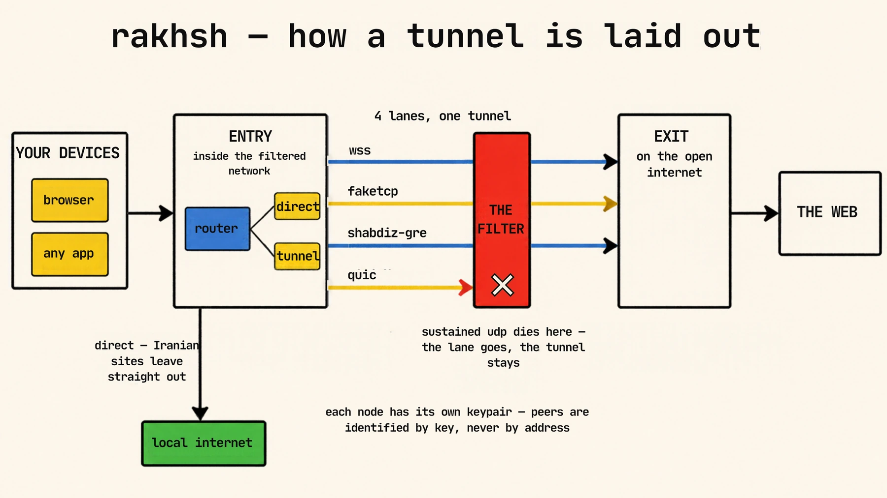
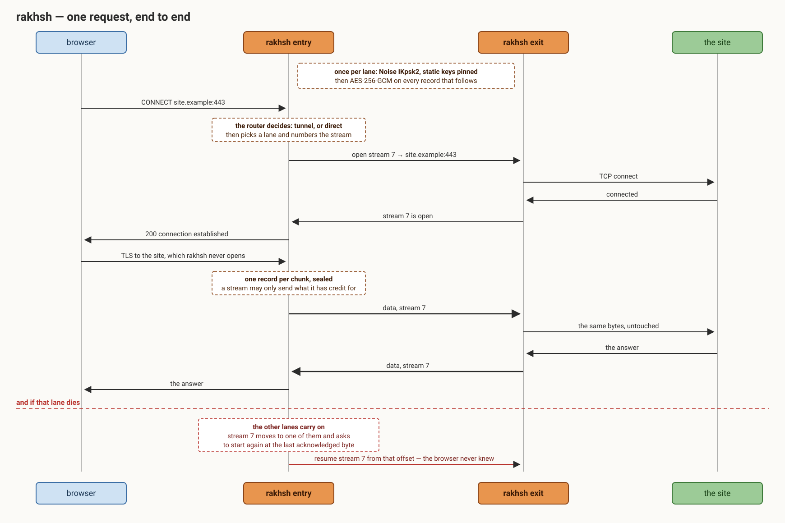

<p align="center">
  
</p>

<p align="center">
  <b>English</b> · <a href="README.fa.md">فارسی</a>
</p>

# rakhsh

A network core written in Rust. It takes traffic from where it starts to where it should come
out — directly on one machine, or tunnelled across as many servers as you have — and it is built
to keep working on networks that are trying to stop it.

One binary. What it becomes is decided by its config: a standalone node, the near end of a
tunnel, the far end, or a whole fleet of each.

## How it is laid out

<p align="center">
  
</p>

## What happens to a request

<p align="center">
  
</p>

## What it is

**A router with a tunnel in it**, rather than a tunnel with a router bolted on. Traffic arrives at
an inbound, the router decides what to do with it, and it leaves through an outbound — direct, or
through the tunnel. The same decision engine runs whether or not a tunnel exists.

**Many carriers, one protocol.** The handshake, the record layer and the multiplexer do not know
how their bytes cross the network. That is a carrier's job, and a carrier can be a plain TCP
connection, TLS, a WebSocket, QUIC, an ARQ over UDP, or frames written straight to the card. When
a network stops carrying one of them, you change one line.

**Lanes, not a connection.** A tunnel is several independent lanes. Losing one costs the streams
that were on it — and with `resume`, not even those: they move to another lane and carry on from
the last byte the far side acknowledged.

**Identities, not addresses.** Every node has its own keypair, and each side lists the identities
it will talk to. An entry can fail over between genuinely separate exits, an exit can serve many
entries, and removing one node changes nothing for the rest.

**Encrypted and authenticated end to end.** Noise IKpsk2 with pinned static keys and a pre-shared
key derived from the token, then AES-256-GCM on every record.

## Install

One line on a bare server — it fetches the binaries, asks a handful of questions, writes the
config, installs the service, and hands you a link for the other end:

```
bash <(curl -fsSL https://raw.githubusercontent.com/CluvexStudio/rakhsh/main/install.sh)
```

On the second server there is nothing to answer at all — paste the line the first one printed:

```
bash <(curl -fsSL .../install.sh) --join rakhsh://…
```

`--panel` sets up the web panel and prints its generated username and password. `--help` lists
the rest. Or build it yourself:

```
cargo build --release
sudo install -m755 target/release/rakhsh /usr/local/bin/rakhsh
```

## A tunnel, from nothing

```
rakhsh init --tunnel-addr <public-address>:7000 --carrier wss --proxy 127.0.0.1:1080
```

That prints a matched pair of configs with fresh keys and a token: one for the near side, one for
the far side. Put each on its host, then:

```
rakhsh check -c /etc/rakhsh.toml     # read the config back in plain words
rakhsh install -c /etc/rakhsh.toml   # run it as a service
rakhsh status                        # lanes, throughput, loss, cpu — live
```

## A fleet, from nothing

Several servers on each side, every one with its own key:

```
rakhsh fleet --exit de=1.2.3.4 --exit nl=5.6.7.8 \
             --entry a=10.0.0.1 --entry b=10.0.0.2 \
             --carrier wss --proxy 0.0.0.0:1080 -o ./fleet
```

One config per node, plus one for the host that manages them. Every exit admits every entry and
the other way round, so a node can leave without taking the fleet with it.

## The config

```toml
role = "entry"
carrier = "wss"
sni = "www.example.com"
tunnel_listen = "0.0.0.0:7000"
lanes = 4

[[peer]]
name = "de"
public = "the other node's public key"
connect = "1.2.3.4:7000"

[[forward]]
listen = "0.0.0.0:443"
target = "127.0.0.1:8443"

[[inbound]]
tag = "proxy"
type = "mixed"
listen = "127.0.0.1:1080"

[route]
final = "tunnel"
```

[`rakhsh.example.toml`](rakhsh.example.toml) is the annotated reference: every key the parser
accepts, exactly once, with its default, its units and which side reads it. A test fails if a key
is missing from it, or if it names one the parser does not read.

[`examples/`](examples) holds configs to start from instead — a working pair per shape, each one
checked by the same test:

| | |
|---|---|
| [`entry.toml`](examples/entry.toml) + [`exit.toml`](examples/exit.toml) | a tunnel over wss, with a forward, a proxy and a resolver |
| [`openvpn-entry.toml`](examples/openvpn-entry.toml) + [`openvpn-exit.toml`](examples/openvpn-exit.toml) | OpenVPN over a datagram carrier |
| [`l3-entry.toml`](examples/l3-entry.toml) + [`l3-exit.toml`](examples/l3-exit.toml) | a routed tun device instead of forwards |
| [`raw-entry.toml`](examples/raw-entry.toml) + [`raw-exit.toml`](examples/raw-exit.toml) | forged TCP packets |
| [`node.toml`](examples/node.toml) | a proxy and router on one host, no tunnel |

Their identity values are obvious placeholders; `rakhsh init` writes keys that correspond.

`rakhsh check` reads any config back as prose, including the parts you did not set, and says when a
key you did set is one this configuration never reads — so a line that does nothing says so instead
of looking configured.

## More

| | |
|---|---|
| [CORE.md](CORE.md) | inbounds, outbounds and the router |
| [LINKS.md](LINKS.md) | several ways to reach a peer, and how one is chosen |
| [SHABDIZ.md](SHABDIZ.md) | the datagram carrier, for paths that refuse everything else |
| [RESUME.md](RESUME.md) | keeping streams alive across a lane's death |
| [DNS.md](DNS.md) | the resolver and split routing |
| [LIMITS.md](LIMITS.md) | quotas and rate limits |
| [CONTROL.md](CONTROL.md) | watching and managing a fleet from one host |
| [SECURITY.md](SECURITY.md) | the threat model, and what is actually protected |

## License

AGPL-3.0-only. See [LICENSE](LICENSE).
